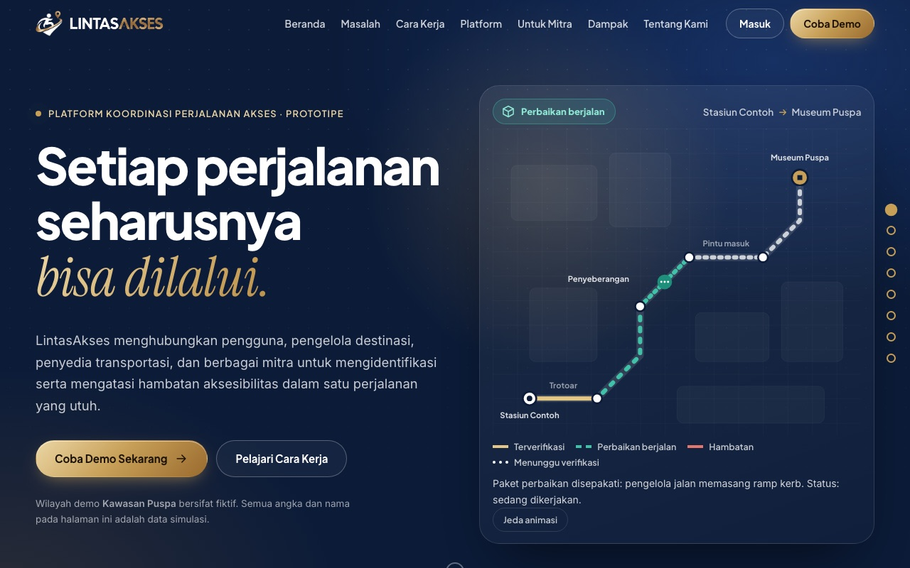
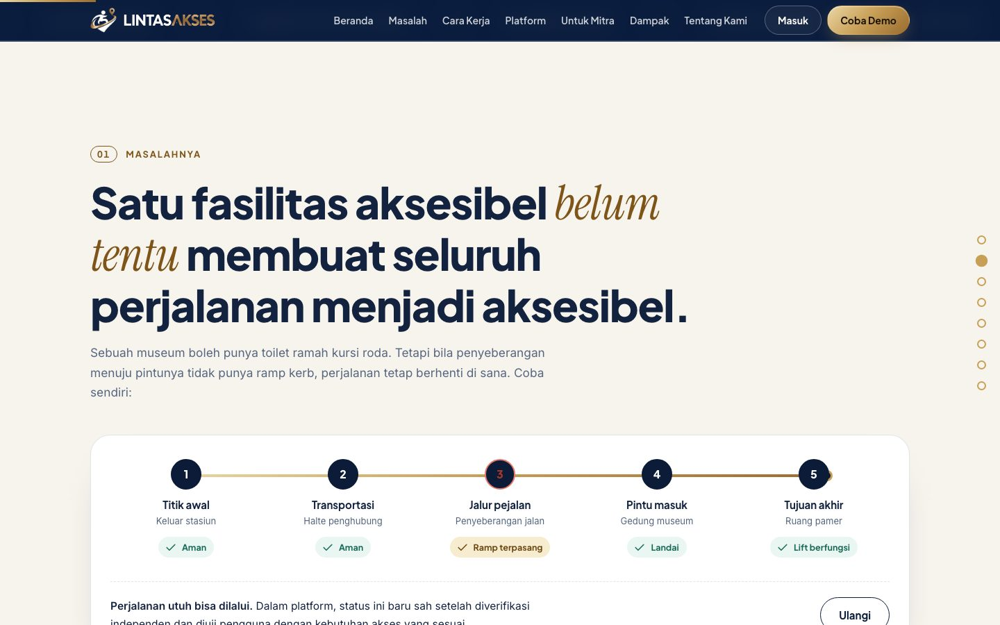
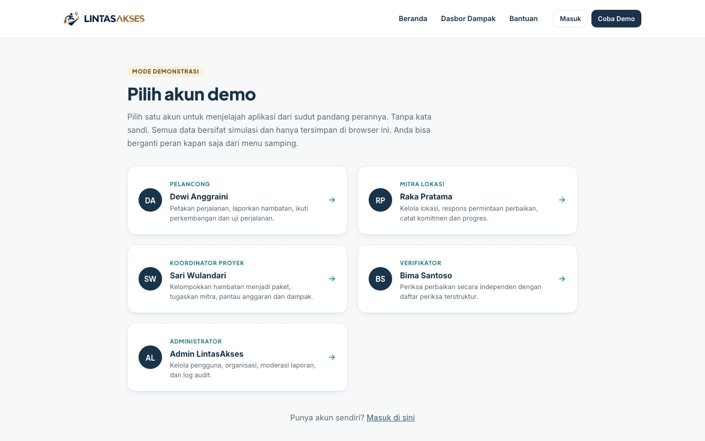
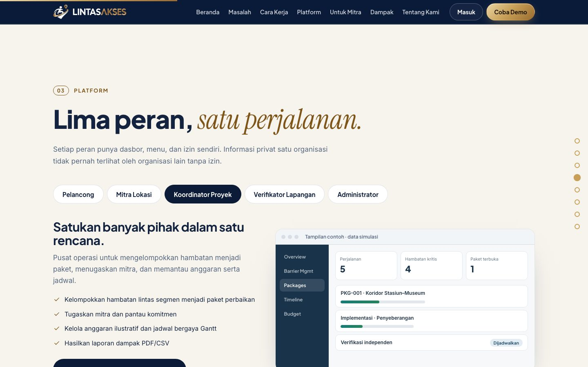
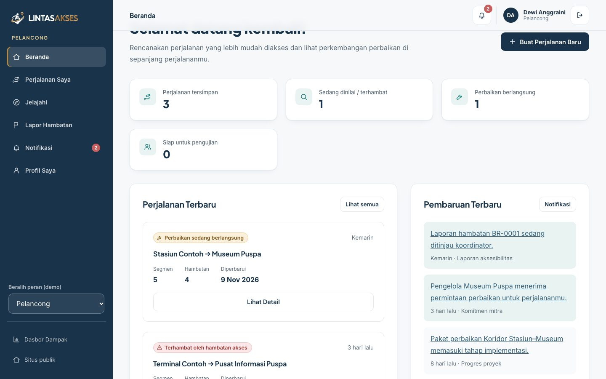
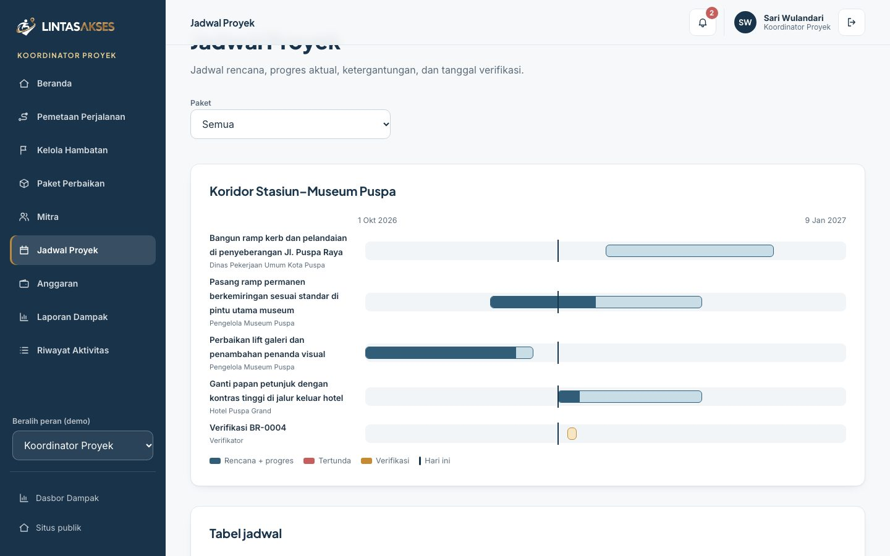
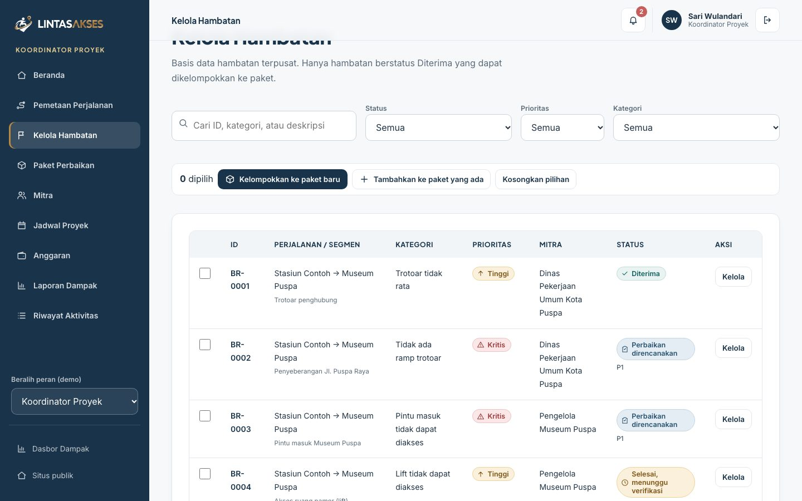
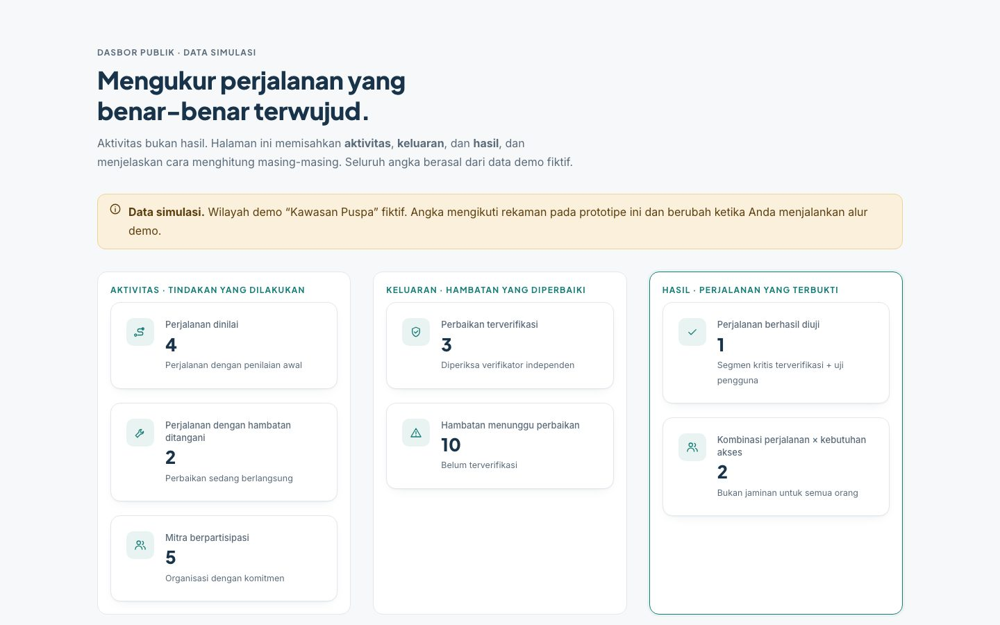

<div align="center">


### Every Journey, Within Reach.

<p>Platform koordinasi perjalanan akses ujung ke ujung: memetakan hambatan, mengoordinasikan perbaikan lintas mitra, dan memverifikasi bahwa perjalanan benar-benar bisa dilalui.</p>

<p>   </p>

<p><a href="https://lintasakses.vercel.app"><b>Lihat demo langsung &rarr;</b></a></p>
</div>

<p align="center">
  
</p>

> **Prototipe.** Seluruh data berasal dari wilayah fiktif "Kawasan Puspa" dan tersimpan di `localStorage` browser. Tidak ada server, pembayaran, atau peta langsung.

## Kenapa LintasAkses?

Satu fasilitas aksesibel belum tentu membuat seluruh perjalanan aksesibel. Museum boleh punya toilet ramah kursi roda, tetapi bila penyeberangan menuju pintunya tidak punya ramp kerb, perjalanan tetap berhenti di sana. LintasAkses memperlakukan **perjalanan utuh** sebagai satuan kerja, bukan satu lokasi.

<p align="center">
  
</p>

## Fitur utama

### Satu platform, lima peran

Pelancong, Mitra Lokasi, Koordinator Proyek, Verifikator, dan Administrator masing-masing punya dasbor sendiri. Pilih akun demo tanpa kata sandi, lalu berganti peran kapan saja dari menu samping.

<p align="center">
  
</p>

<p align="center">
  
</p>

### Pelancong: rencanakan tanpa menebak-nebak

Susun perjalanan per segmen, pilih kebutuhan akses tanpa menyebut diagnosis, lapor hambatan dengan bukti, dan ikut menguji perjalanan setelah diverifikasi.

<p align="center">
  
</p>

### Koordinator: satukan banyak pihak dalam satu rencana

Kelompokkan hambatan lintas segmen menjadi paket perbaikan, tugaskan mitra, pantau jadwal bergaya Gantt dan anggaran ilustratif, lalu hasilkan laporan dampak (PDF/CSV).

<p align="center">
  
</p>

<p align="center">
  
</p>

### Verifikasi independen dan dasbor dampak

Verifikator mengisi daftar periksa terstruktur dengan bukti foto, lalu memutuskan: terverifikasi, sebagian, tidak, atau uji ulang. Hasilnya tampil di dasbor dampak publik.

<p align="center">
  
</p>

## Menjalankan

Butuh Node.js saja, tanpa install dependensi dan tanpa build step.

```bash
npm run dev
```

Lalu buka:

| Alamat | Isi |
|---|---|
| `http://localhost:8765/` | Company profile |
| `http://localhost:8765/app/index.html#/demo` | Pilih akun demo |
| `http://localhost:8765/app/index.html#/impact` | Dasbor dampak publik |

Port pindah otomatis bila terpakai. Untuk mengatur ulang data demo, buka menu **Atur ulang data demo** di aplikasi.

## Struktur

| Bagian | File |
|---|---|
| Company profile (animasi) | `index.html`, `assets/profile.css`, `assets/profile.js` |
| Aplikasi lima peran + dasbor dampak | `app/` (hash-router, vanilla JS) |
| Logo transparan | `assets/logo/` |
| Server statis lokal | `dev.mjs` |

## Catatan jujur

- Semua data fiktif dan hanya tersimpan di browser Anda.
- Verifikasi adalah penilaian internal, bukan sertifikasi pemerintah.
- Angka anggaran bersifat ilustratif.

## Author & License

Created by Vassel Goleyu. Copyright (c) 2026 Vassel Goleyu. All rights reserved. Lihat [LICENSE](LICENSE).
